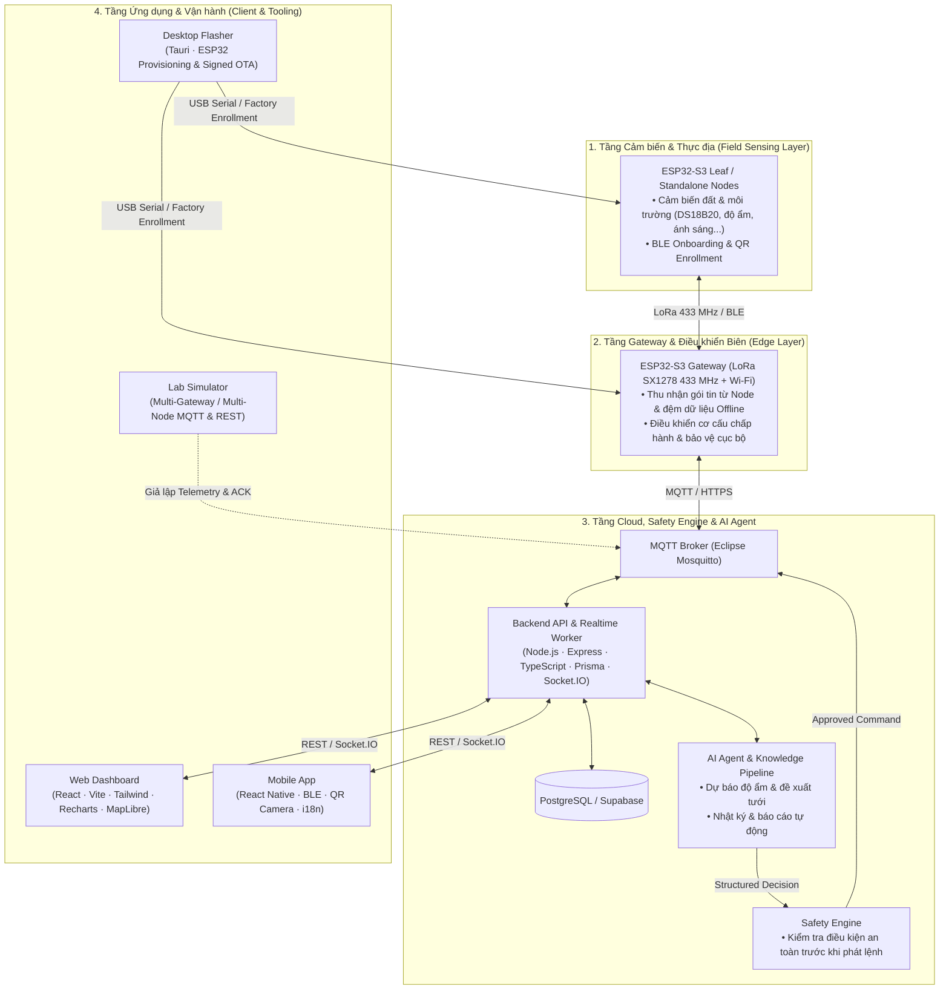

<div align="center">

# 🌾 FarmOS — Smart Agriculture Platform Powered by IoT & AI Agent

**Hệ thống nông nghiệp thông minh đa vùng ứng dụng công nghệ AIoT và AI Agent giám sát & chăm sóc cây trồng tự động**

[]()
[]()
[]()
[]()

</div>

---

## 📌 Tổng quan dự án

**FarmOS** là nền tảng **AIoT Retrofit** dành cho nông nghiệp thông minh đa phân vùng (**Farm – Zone – Node**), kết hợp phần cứng nhúng (ESP32-S3 + LoRa SX1278), hạ tầng Cloud/Edge (MQTT + REST API + WebSocket), ứng dụng Web/Mobile, công cụ nạp firmware Desktop, và **AI Agent** hỗ trợ phân tích dữ liệu, dự báo độ ẩm đất và đề xuất lịch tưới đi qua lớp kiểm định an toàn (**Safety Engine**).

- **Ngày hoàn thành:** `26/11/2026`

### 👥 Tác giả

- **Lê Văn Duy**
- **Nguyễn Văn Đường**
- **Phạm Thị Ngọc Nhi**
- **Trần Duy Mạnh**
- **Tăng Anh Kiệt**

---

## 🏛️ Kiến trúc hệ thống



---

## 📂 Cấu trúc kho lưu trữ

```text
.
├── Hardware/                       # Thiết kế PCB Altium (.PcbDoc), Schematic (.pdf), mô hình 3D (.step, .png)
├── File in 3d của hộp/             # File in 3D vỏ hộp bảo vệ (.stl) và hình ảnh thực tế
├── Software/                       # Toàn bộ mã nguồn hệ thống FarmOS
│   ├── backend/                    # REST API, MQTT worker, Prisma DB, Safety Engine, AI Agent, OTA
│   ├── frontend/                   # Web Dashboard (React + TypeScript + Vite + Tailwind CSS)
│   ├── mobile/                     # Mobile App (React Native + BLE + QR Onboarding + MapLibre)
│   ├── firmware/                   # Firmware ESP32-S3 (gateway, gateway-wroom, node, shared, tests)
│   ├── desktop-flasher/            # Ứng dụng Desktop (Tauri) nạp firmware & quản lý xuất xưởng
│   ├── simulator/                  # Trình giả lập đa Gateway / đa Node (Web Control Panel cổng 4000)
│   ├── deploy/                     # Cấu hình triển khai production
│   ├── docs/                       # Tài liệu kỹ thuật (User Guide, Lifecycle, Manufacturing QR, OTA, Config)
│   ├── scripts/                    # Script kiểm tra cấu hình & giả lập MQTT
│   ├── tools/                      # Công cụ build & ký firmware tự động
│   └── docker-compose*.yml         # Cấu hình Docker Compose (dev, simulation, standalone, production)
└── Video/                          # Video demo vận hành thực tế (Onboarding, Web, Mobile, AI Forecast)
```

---

## 🛠️ Công nghệ sử dụng

| Phân hệ | Công nghệ & Công cụ chính |
| :--- | :--- |
| **Phần cứng & Cơ khí** | ESP32-S3 N16R8, LoRa SX1278 (433 MHz), Altium Designer (PCB & Schematic), In 3D (STL / STEP) |
| **Firmware (`v0.2.26`)** | ESP-IDF / PlatformIO, BLE Provisioning, Signed QR Enrollment & Signed OTA |
| **Backend & AI** | Node.js, TypeScript, Express, Prisma ORM, PostgreSQL / Supabase, Eclipse Mosquitto (MQTT), Socket.IO, Zod |
| **Web Frontend** | React 18, TypeScript, Vite, Tailwind CSS, Recharts, Leaflet, MapLibre GL |
| **Mobile App** | React Native `0.87`, TypeScript, `react-native-ble-plx`, Vision Camera, MapLibre, `i18next` |
| **Desktop Flasher** | Tauri (Rust + React/Vite), `esptool` Python wrapper (`farmos_esptool.py`) |
| **Hạ tầng & DevOps** | Docker, Docker Compose, Cloudflare Tunnel (`cloudflared`), Simulator |

---

## 🚀 Hướng dẫn khởi chạy nhanh (Software)

> Chi tiết đầy đủ về kiến trúc phần mềm, cấu hình `.env` và quy trình nạp firmware xem thêm tại [`Software/README.md`](Software/README.md) và thư mục [`Software/docs/`](Software/docs/).

### 1. Chuẩn bị biến môi trường & kiểm tra cấu hình

```bash
cd Software
cp .env.example .env
npm run config:check
npm run config:generate
```

### 2. Khởi chạy hạ tầng bằng Docker Compose

```bash
cd Software
docker compose up -d
```

### 3. Build kiểm tra toàn bộ workspace

```bash
cd Software
npm run build
```

### 4. Chạy bộ giả lập thiết bị (Lab Simulator)

```bash
cd Software/simulator
npm install
npm run dev
# Truy cập Web Control Panel tại http://localhost:4000
```

---

## 📄 Tài liệu kỹ thuật & Demo

- **Tài liệu kỹ thuật phần mềm:** [`Software/docs/`](Software/docs/) (`USER_GUIDE.md`, `DEVICE_LIFECYCLE.md`, `MANUFACTURING_QR.md`, `OTA.md`, `CONFIG_CONTRACT.md`, `TEST_REPORT_2026-09-05.md`)
- **Sơ đồ phần cứng & Vỏ hộp 3D:** [`Hardware/`](Hardware/) & [`File in 3d của hộp/`](File%20in%203d%20c%E1%BB%A7a%20h%E1%BB%99p/)
- **Video demo hệ thống:** [`Video/`](Video/)

---

<div align="center">
  <sub>FarmOS · Hoàn thành ngày 26/11/2026</sub>
</div>
