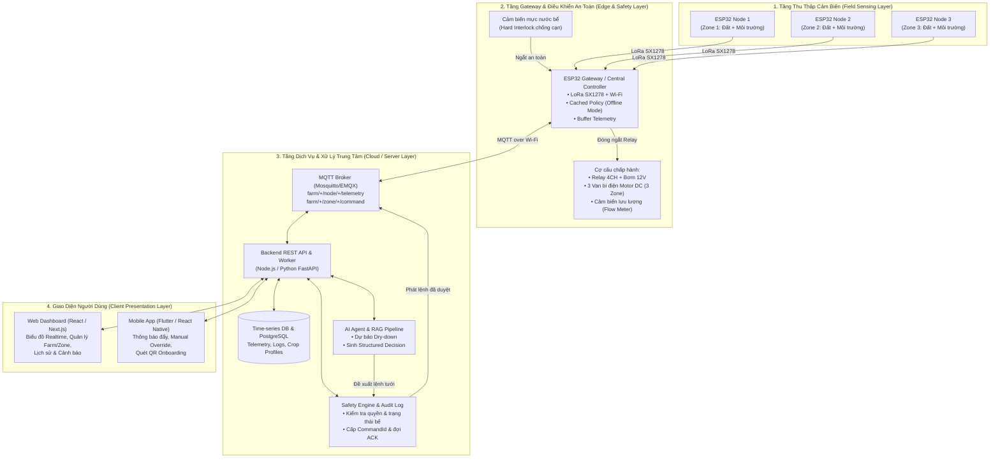

# 🌾 FarmOS — AIoT Retrofit Platform for Smart Agriculture

> **Hệ thống nông nghiệp thông minh đa vùng ứng dụng công nghệ AIoT và AI Agent hỗ trợ quyết định tưới chính xác theo dữ liệu.**

> [!IMPORTANT]
> Luồng thiết bị đang triển khai hỗ trợ một QR và ba chế độ `GATEWAY`,
> `LEAF_NODE`, `STANDALONE_NODE`. Xem [hướng dẫn sử dụng hiện hành](docs/USER_GUIDE.md),
> [quy trình factory/QR v3](docs/MANUFACTURING_QR.md) và
> [Admin Web Serial flasher](docs/USER_GUIDE.md#12-admin-web-serial-flasher),
> [flash contract](backend/FLASH_CONTRACT.md) và [giới hạn kiểm chứng](docs/DEVICE_LIFECYCLE.md).
> Sơ đồ MQTT, relay/bơm/van và
> Safety Engine bên dưới là kiến trúc mục tiêu; firmware vật lý hiện gửi telemetry
> qua HTTPS và mới đọc DS18B20, chưa phải bằng chứng các cơ cấu tưới đã hoạt động.

[](#-kiến-trúc-hệ-thống)
[](#-phần-cứng--firmware)
[](#-giao-thức--dữ-liệu)
[](#-nguyên-tắc-an-toàn-safety-engine)

---

## 📌 1. Giới thiệu tổng quan (Project Brief)

**FarmOS** là nền tảng **AIoT Retrofit** được thiết kế nhằm hiện đại hóa các trang trại và vườn cây quy mô vừa & nhỏ. Hệ thống tận dụng lại cơ sở hạ tầng tưới tiêu sẵn có (bơm, van, bồn nước, đường ống) và bổ sung lớp giám sát thông minh đa phân vùng (**Farm – Zone – Node**), hỗ trợ ra quyết định bằng **AI Agent & RAG (Hồ sơ cây trồng)**, đồng thời đảm bảo an toàn tuyệt đối thông qua **Safety Engine** và khả năng vận hành độc lập khi mất kết nối Internet.

### 🎯 Mục tiêu cốt lõi:
* **Giám sát đa vùng độc lập (3-Zone Prototype):** Thu thập liên tục độ ẩm đất, nhiệt độ đất, nhiệt độ/độ ẩm không khí, cường độ ánh sáng theo thời gian thực.
* **Tưới chính xác theo dữ liệu & AI:** Sử dụng mô hình dự báo tốc độ mất ẩm (*Dry-down rate*) kết hợp tri thức cây trồng (*Crop Profiles*) để đề xuất lịch tưới tối ưu.
* **An toàn & Chống rủi ro phần cứng:** Bộ điều khiển trung tâm tích hợp khóa liên động (*Hard Interlock*) mực nước bể chống cháy bơm, giới hạn thời gian chạy tối đa (*Max Runtime*), chống kẹt van và phát hiện không có dòng chảy (*No-flow timeout*).
* **Vận hành Offline tin cậy:** Khi mất mạng Internet, Gateway tự động áp dụng *Cached Policy* cục bộ, lưu đệm dữ liệu (*Buffer*) và đồng bộ (*Sync*) khi có mạng trở lại.

---

## 🏛️ 2. Kiến trúc Hệ thống (System Architecture)



---

## 📂 3. Cấu trúc Thư mục Dự án (Project Structure)

```text
FarmOS/
├── 📁 firmware/                      # Mã nguồn nhúng ESP32 / LoRa / Sensors
│   ├── 📁 node/                      # Firmware cho Node cảm biến 3 Zone
│   ├── 📁 gateway/                   # Firmware cho Gateway / Central Controller
│   └── 📁 shared/                    # Header cấu trúc gói tin LoRa & mã lỗi chung
│
├── 📁 backend/                       # Server Backend, API, Database & AI Agent
│   ├── 📁 src/
│   │   ├── 📁 api/                   # REST API routes, controllers, auth
│   │   ├── 📁 mqtt/                  # MQTT subscriber/publisher worker
│   │   ├── 📁 safety_engine/         # Logic kiểm tra an toàn & cấp phép tưới
│   │   ├── 📁 ai_agent/              # AI Agent, RAG Crop Profiles & Forecast model
│   │   ├── 📁 database/              # DB schemas, migrations, models
│   │   └── 📁 config/                # Biến môi trường & cấu hình hệ thống
│   ├── Dockerfile
│   └── package.json (hoặc requirements.txt)
│
├── 📁 frontend/                      # Web Dashboard Quản trị đa vùng
│   ├── 📁 src/
│   │   ├── 📁 components/            # UI components (Gauge, Chart, Switch, Logs)
│   │   ├── 📁 pages/                 # Dashboard, Zones, Crop Profiles, Settings
│   │   ├── 📁 hooks/                 # WebSocket/MQTT realtime hooks
│   │   └── 📁 services/              # API clients
│   └── package.json
│
├── 📁 mobile/                        # Ứng dụng Di động cho Nông dân (Flutter / React Native)
│   ├── 📁 lib/
│   │   ├── 📁 screens/               # Màn hình Zone Overview, Manual Controls, Alerts
│   │   ├── 📁 widgets/               # UI widgets & components
│   │   ├── 📁 services/              # Notification & API Service
│   │   └── 📁 qr_scanner/            # Quét mã QR Onboarding thêm Node (NFR-06)
│   └── pubspec.yaml
│
├── 📁 hardware/                      # Thiết kế sơ đồ nguyên lý & phần cứng
│   ├── 📁 schematics/                # Sơ đồ nguyên lý mạch (KiCad / Fritzing)
│   ├── 📁 pcb/                       # Bản vẽ mạch in PCB
│   └── 📁 3d_models/                 # Vỏ hộp bảo vệ ngoài trời (STL/CAD)
│
├── 📁 docs/                          # Hồ sơ thiết kế & Báo cáo kỹ thuật
│   ├── 📁 asu_design/                # Báo cáo chuẩn ASU Design Template
│   ├── 📁 architecture_diagrams/     # Sơ đồ khối, sơ đồ luồng dữ liệu
│   ├── 📁 reports/                   # Mẫu báo cáo chính thức (IEEE docx)
│   └── 📁 test_records/              # Bằng chứng kiểm thử kịch bản T01 - T06
│
├── 📁 scripts/                       # Công cụ Dev Tools & Giả lập dữ liệu
│   ├── mock_mqtt_node.py             # Giả lập 3 Node cảm biến bắn MQTT để test Backend
│   └── seed_database.py              # Tạo dữ liệu mẫu ban đầu
│
├── docker-compose.yml                # Khởi động MQTT Broker + DB + Backend + Web chỉ 1 lệnh
├── .env.example                      # Mẫu cấu hình môi trường
└── README.md                         # Tài liệu mô tả dự án
```

---

## 📡 4. Giao thức Truyền thông & Chuẩn Dữ liệu (MQTT Topics)

Hệ thống chuẩn hóa định dạng giao tiếp qua MQTT với cấu trúc phân cấp:

| MQTT Topic | Hướng | Mô tả & Dữ liệu chính (Payload JSON) |
| :--- | :---: | :--- |
| `farm/{farmId}/node/{nodeId}/telemetry` | Node ➔ Server | `{"timestamp": 1724300000, "zoneId": "Z01", "soil_moisture": 45.2, "soil_temp": 26.5, "air_temp": 29.1, "air_humidity": 75.0, "lux": 15200, "quality": 1}` |
| `farm/{farmId}/node/{nodeId}/status` | Node/GW ➔ Server | `{"online": true, "firmware": "v1.0.2", "rssi": -65}` |
| `farm/{farmId}/zone/{zoneId}/command` | Server ➔ GW | `{"commandId": "cmd-8891", "action": "irrigate", "duration_sec": 240, "valve_id": "V01", "policy_version": "v2"}` |
| `farm/{farmId}/node/{nodeId}/ack` | GW ➔ Server | `{"commandId": "cmd-8891", "status": "COMPLETED", "measured_flow_liters": 15.6, "error_code": 0}` |

---

## 🛡️ 5. Nguyên tắc An toàn (Safety Engine)

> [!IMPORTANT]
> **AI Agent KHÔNG BAO GIỜ điều khiển trực tiếp Relay/Bơm.**
> Mọi đề xuất tưới đều được đóng gói dưới dạng **Structured Decision** và phải đi qua **Safety Engine** kiểm định:
>
> 1. **Water Level Check:** Cảm biến bể nước ngắt cứng nguồn bơm nếu mực nước dưới ngưỡng an toàn.
> 2. **Max Runtime Limit:** Giới hạn thời gian tưới tối đa cho mỗi lần kích hoạt (tránh úng hoặc ngập khi sự cố).
> 3. **No-Flow Detection:** Tự ngắt bơm sau 15 giây nếu van mở nhưng cảm biến lưu lượng (Flow meter) không ghi nhận dòng chảy.
> 4. **Manual Override Priority:** Lệnh dừng khẩn cấp (*Emergency Stop*) hoặc thao tác thủ công từ người dùng luôn có mức ưu tiên cao nhất.
> 5. **Traceability:** Mọi lệnh đều có `commandId` và ghi nhật ký kiểm toán (*Audit Log*).

---

## 👥 6. Thành viên Nhóm thực hiện (Team Members)

* **Lê Văn Duy**
* **Nguyễn Văn Đường**
* **Phạm Thị Ngọc Nhi**
* **Trần Duy Mạnh**
* **Tăng Anh Kiệt**

---

## 🚀 7. Hướng dẫn Khởi chạy Nhanh (Quick Start)

### 1. Khởi động môi trường giả lập & hạ tầng (Docker):
```bash
cd Software
docker-compose up -d
```

### 2. Chạy giả lập Node cảm biến bắn dữ liệu MQTT:
```bash
python3 scripts/mock_mqtt_node.py
```

---

*Hồ sơ thiết kế kỹ thuật chi tiết xem tại thư mục [`docs/asu_design/`](docs/asu_design/).*
