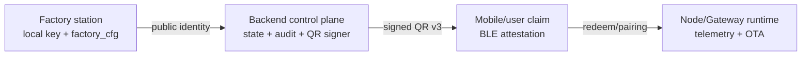

# FarmOS: factory identity và QR v3

Tài liệu này là runbook cho dây chuyền cấp identity, ghi `factory_cfg` và phát
hành label QR v3. Nó mô tả contract hiện có trong backend, firmware và
`tools/manufacturing/factory_station.py`; không phải bằng chứng một bo thật đã
được ghi flash, đọc lại hoặc claim thành công. Không dùng quy trình này để test
production hoặc thay thế phê duyệt phần cứng.

## 1. Kiến trúc ba lớp

| Lớp | Thành phần | Quyền sở hữu và dữ liệu chính |
| --- | --- | --- |
| Factory/device identity | Factory station, ESP32 Node/Gateway, partition `factory_cfg` | Station tạo ECDSA P-256 private key cục bộ; bo giữ private/public key, `identity_version`, model, revision, firmware target, serial và device ID. Private key không gửi backend, không đưa vào QR và không in ra log. |
| Control plane | Backend `/api/v1/manufacturing`, QR signer, Prisma/PostgreSQL | Cấp batch/identity, lưu public key và fingerprint, kiểm soát state machine, ký QR Ed25519 và lưu lifecycle audit. Manufacturing API yêu cầu station credential/mTLS hoặc admin session và `Idempotency-Key` cho mutation. |
| User/runtime | Mobile QR resolve/claim, BLE attestation, cloud redeem/pairing, Node/Gateway telemetry | QR v3 chỉ là public metadata có chữ ký. User claim dùng session ngắn hạn từ server, BLE challenge-response bind session/nonce/device, sau đó mới ghi cấu hình và redeem/pairing. |

Luồng tổng quát:



Các route được mount dưới `/api/v1` trong `backend/src/api/app.ts`. Route factory
không tự ghi flash vật lý; station phải ghi image bằng quy trình thiết bị đã
được phê duyệt rồi mới dùng readback để chứng minh image khớp.

## 2. Identity v3 và QR v3

### 2.1 Factory identity

Mỗi bo phải có identity riêng, tối thiểu gồm:

- `identity_version` = `3`;
- `device_id`, `serial`, `model`, `hardware_revision`, `firmware_target`;
- `public_key` của attestation key, `cert_fingerprint` (tên field tương thích;
  giá trị hiện tại là SHA-256 của DER SubjectPublicKeyInfo), và algorithm;
- `attestation_private_key` trong `factory_cfg` của bo. Đây là private key nhạy
  cảm, station tạo cục bộ và không upload. Public key/fingerprint được đăng ký
  với backend để verify claim;
- Node có thêm `radio_id`; radio ID phải khớp phần số của `NODE_<numeric>`.

Production identity không dùng `possessionCode`, `setup_secret` hoặc secret sở
hữu làm BLE identity. `CONFIG_FARMOS_DEVELOPMENT_IDENTITY` chỉ dành cho bench
build explicit; production phải tắt cờ legacy này. Backend vẫn có thể giữ
`claim_code_hash`/`stationProvisioning` cho compatibility của API cũ, nhưng đó
không phải dữ liệu được in trong QR v3 hoặc ghi vào identity production.

Quy ước mà factory station hiện validate:

- Node: `NODE_<numeric>`; phần số là u32 khác 0 và nếu có `--radio-id` thì phải
  bằng radio ID.
- Gateway: station CLI sinh/nhận `GATEWAY_<numeric>`.

Backend allocate, factory station và firmware đều phải dùng Gateway dạng
`GATEWAY_<numeric>` với phần số là u32 khác 0. Nếu một API/fixture cũ còn sinh
ID hex hoặc ID không phải số, hãy dừng batch và sửa contract trước khi ghi bo;
không dùng ID đó để lách validation của station/firmware.

### 2.2 QR v3 payload

Payload signed có đúng các field sau, theo canonical order của backend:

```json
{
  "v": 3,
  "issuer": "farmos",
  "qrId": "QR3-...",
  "deviceId": "NODE_000007",
  "serial": "FARMOS-000007",
  "type": "SENSOR_NODE",
  "model": "FARMOS_ESP32S3",
  "hardwareRevision": "REV_A",
  "kid": "prod-2026-01",
  "sig": "base64url-signature"
}
```

`sig` là chữ ký Ed25519 base64url không padding trên canonical JSON của chín
field đầu. QR v3 không có `claimCode`, `possessionCode`, `setup_secret`, Wi-Fi
password, cloud token, public/private attestation key hay certificate private
key. `kid` chỉ trỏ đến QR verification key; QR signing private key chỉ nằm ở
server. QR resolve public có thể dùng:

- `POST /api/v1/onboarding/qr/resolve`;
- alias `POST /api/v1/onboarding/devices/resolve-qr-v3`.

Resolve kiểm tra chữ ký, label và factory identity; claim thật vẫn cần user
authentication và identity server state `READY_TO_SHIP` cùng label đã `PRINTED`
hoặc `REPRINTED`.

## 3. Canonical BLE attestation contract

Đây là contract cho firmware hiện tại và backend `/onboarding/qr/claim-sessions`.
Firmware không ký chuỗi challenge thô. Backend cũng không verify plain
`challenge`; nó verify đúng transcript digest dưới đây.

### 3.1 Server challenge và BLE request

`POST /api/v1/onboarding/qr/claim-sessions` trả `sessionId`,
`provisioningToken` (chính là challenge ngắn hạn), `nonce`, `identityVersion`,
`expiresAt` và `status`. Nonce canonical là:

```text
base64url_no_padding(SHA256(UTF-8("farmos-ble-nonce:" + challenge))[0:24])
```

Claim `LEAF_NODE` hết hạn trong 5 phút; `GATEWAY` và `STANDALONE_NODE` trong 10
phút. BLE request được gửi dạng UTF-8 JSON (BLE library có thể base64-wrap byte
để gọi API thư viện):

```json
{
  "op": "CHALLENGE",
  "deviceId": "NODE_000007",
  "sessionId": "claim-session-7",
  "provisioningToken": "<server challenge>",
  "nonce": "<canonical nonce>",
  "ttlMs": 300000
}
```

Firmware yêu cầu `deviceId` đúng factory identity, `sessionId` an toàn, token và
nonce đúng format, `16 <= nonce bytes <= 32`, và `1 <= ttlMs <= 300000`. Challenge
được lưu trong RAM với expiry; signature cũ không được tái sử dụng cho session
hoặc nonce khác.

### 3.2 Transcript và signature

Đặt `LP(x) = u32_be(len(x)) || x`, trong đó string là UTF-8 và byte field không
được chuyển thành hex/text. Transcript bytes là:

```text
LP("farmos-ble-provision-v3")
|| LP(UTF8(deviceId))
|| LP(UTF8(sessionId))
|| LP(SHA256(UTF8(provisioningToken)))
|| LP(nonce_bytes)
|| u32_be(identityVersion)
```

`transcriptDigest = SHA256(transcript bytes)`. Factory station hiện tạo ECDSA
P-256 key; firmware ký bằng ECDSA-SHA256 trên `transcriptDigest` (tức input
hiệu dụng là `SHA256(transcriptDigest)` theo API ký mbedTLS/Node hiện tại).
Signature trả về là DER ECDSA base64url không padding. Backend nhận
`signature`, `provisioningToken` và `nonce`, tự dựng lại digest từ session đã
lưu và verify bằng public key factory đã đăng ký; không tin public key do BLE
response gửi lên.

BLE response thành công có dạng tương đương:

```json
{
  "status": "CHALLENGE_ACCEPTED",
  "deviceId": "NODE_000007",
  "identityVersion": 3,
  "sessionId": "claim-session-7",
  "signatureFormat": "transcript-v1",
  "nonce": "<same canonical nonce>",
  "expiresAtMs": 0,
  "signature": "<DER ECDSA-P256-SHA256, base64url>",
  "publicKey": "<SPKI DER, standard base64>",
  "certFingerprint": "<SPKI SHA-256>"
}
```

`publicKey` và `certFingerprint` trong response chỉ để đối chiếu/audit; authority
là public key đã lưu ở backend. Mobile gửi signature/nonce/token lên:

```text
POST /api/v1/onboarding/qr/claim-sessions/:id/attest
body: { signature, provisioningToken, nonce }
```

Sau khi finalize, cấu hình BLE production vẫn bind đủ
`deviceId` (hoặc `nodeId`), `sessionId`, `provisioningToken`, `nonce` và
`signature`. Payload không có các field auth thì chỉ được firmware chấp nhận
trong development identity build; production phải reject.

Vector đã commit để kiểm tra liên ngôn ngữ:

- `tools/manufacturing/attestation_v3_vector.json` (P-256, vector station);
- `backend/src/manufacturing/attestation-vector.json` (digest/signature vector
  backend test).

Các test phải chứng minh signature của transcript verify và signature của plain
challenge bị reject. Nếu một implementation ký `challenge` hoặc dùng nonce
text thay cho nonce bytes, đó là contract mismatch.

## 4. Quy trình batch đến ready-to-ship

State server phải đi theo thứ tự vận hành sau:

```text
batch DRAFT/OPEN
  -> allocate (identity ALLOCATED)
  -> factory-write (identity FACTORY_WRITTEN)
  -> physical readback + verify (identity VERIFIED)
  -> QC pass (identity QC_PASSED)
  -> ready-to-ship release (identity READY_TO_SHIP; batch READY_TO_SHIP)
  -> issue QR (label ISSUED)
  -> print-confirm (label PRINTED)
```

`QC_PASSED` và `READY_TO_SHIP` là enum backend và gate hồ sơ nhà máy. Chỉ đóng gói khi
đã có manifest, key custody record, factory image/readback hash, backend
`FACTORY_READBACK_VERIFIED`, QC pass, release, QR `ISSUED` và `PRINTED` (hoặc `REPRINTED` sau khi
đã xác nhận bản in cuối), và người kiểm tra ký release checklist.

### 4.1 API factory thật

Base path là `/api/v1/manufacturing`. Station dùng `x-farmos-station-id` và
`x-farmos-station-token` (hoặc mTLS được backend xác nhận); mọi POST mutation
cần `Idempotency-Key`. Các body chính:

1. `POST /batches`: `batchNumber`, `model`, `type` (`GATEWAY` hoặc
   `SENSOR_NODE`), `hardwareRevision`, `quantity`, tùy chọn `firmwareTarget`.
2. `POST /batches/:batchId/allocate`: `identities` hoặc `quantity`. Mỗi identity
   có thể chỉ rõ `deviceId`, `serial`, `model`, `hardwareRevision`,
   `firmwareTarget`, `partitionScheme`, `capabilities`; type phải khớp batch.
3. `POST /batches/:batchId/factory-written`: `deviceId`, `publicKey` (hoặc
   `devicePublicKey`), `publicKeyFingerprint`, `factoryCfgHash`,
   `firmwareSha256`, `stationId` và `readbackProof`; tùy chọn `claimCode` chỉ
   cho compatibility. Backend kiểm tra exact SHA-256 fields khi chúng được gửi;
   hash/proof chỉ được lưu sau strict readback và route chuyển
   `ALLOCATED -> FACTORY_WRITTEN`.
4. `POST /batches/:batchId/factory-readback`: `deviceId` và `readback` với
   `deviceId`, `serial`, `type`, `model`, `hardwareRevision`, tùy chọn
   `identityVersion` và public key, cùng đúng bộ evidence/hash đã đăng ký ở
   bước factory-written. So khớp xong chuyển `FACTORY_WRITTEN -> VERIFIED`.
5. `POST /batches/:batchId/qc-pass` chuyển identity `VERIFIED -> QC_PASSED`;
   `POST /batches/:batchId/ready-to-ship` release đủ batch sang
   `READY_TO_SHIP`.
6. `POST /qr/issue` với `deviceIds` (tối đa 500) hoặc `deviceId`. Chỉ identity
   và batch `READY_TO_SHIP` mới được cấp label.
7. `POST /qr/:qrId/print-confirm` xác nhận bản in; route alias là
   `/qr/:qrId/confirm-print` hoặc `/labels/:qrId/print-confirm`.

CLI đã tự tạo `Idempotency-Key`; gọi API trực tiếp phải tự tạo key ổn định cho
mỗi thao tác retry.

### 4.2 Reprint, quarantine và revoke

- `POST /qr/:qrId/reprint` (alias `/labels/:qrId/reprint`) tăng `reprint_count`
  và chuyển label sang `REPRINTED`. Ghi reason trong SOP; đây không phải identity
  mới và không tạo QR khác.
- `POST /devices/:deviceId/quarantine` hoặc `POST /qr/:qrId/quarantine` chuyển
  identity sang `QUARANTINED`; label chưa revoked cũng bị quarantine. Không claim
  hoặc ship thiết bị này.
- `POST /qr/:qrId/revoke` (alias `/labels/:qrId/revoke`) chuyển label và
  identity sang `REVOKED`. Đây là trạng thái terminal; không tái sử dụng QR,
  device ID hoặc private key của một identity đã revoke.

Các route này vẫn yêu cầu station/admin authorization và idempotency. Batch có
thể bị `QUARANTINED`/`CANCELLED`; cần dừng toàn bộ label chưa release trong batch.

## 5. Factory station CLI

CLI thực tế là `tools/manufacturing/factory_station.py`. Xem help chính thức:

```bash
python3 tools/manufacturing/factory_station.py --help
```

### 5.1 Credential và allocate

CLI đọc các biến sau, option cùng tên sẽ override env:

```bash
export FARMOS_API_BASE_URL="https://api.example.invalid"
export FARMOS_STATION_ID="station-01"
export FARMOS_STATION_TOKEN="<station-token>"
# FARMOS_BEARER_TOKEN chỉ dùng khi quy trình backend cấp admin bearer phù hợp.
```

Tạo batch nếu chưa truyền `--batch-id`, allocate identity, rồi tạo key P-256 và
manifest local:

```bash
python3 tools/manufacturing/factory_station.py allocate \
  --out ./factory-output \
  --batch-number BATCH-2026-09-01 \
  --quantity 10 \
  --type SENSOR_NODE \
  --model FARMOS_ESP32S3 \
  --hardware-revision REV_A \
  --firmware-target ESP32S3_LORA_SENSOR_V1
```

Gateway dùng `--type GATEWAY` và target `ESP32S3_LORA_GATEWAY_V1`. Có thể dùng
`--batch-id`, `--device-id`, `--radio-id`, `--serial`, `--serial-prefix`,
`--partition-scheme` và `--capabilities`; `--device-id` chỉ hợp lệ khi
`--quantity 1`. Private/public DER nằm dưới từng device directory với mode
0600; không upload private DER.

### 5.2 Generate, factory-write và physical readback

`generate` tạo CSV/NVS image. Station không tự flash bo; kỹ thuật viên dùng tool
flash đã được phê duyệt, rồi `readback` bắt buộc đọc đủ partition `factory_cfg`
từ cổng serial và bind hash firmware release:

```bash
python3 tools/manufacturing/factory_station.py generate \
  ./factory-output/NODE_000007/manifest.json \
  --nvs-generator /path/to/esp-idf/components/nvs_flash/nvs_partition_generator/nvs_partition_gen.py

python3 tools/manufacturing/factory_station.py readback \
  ./factory-output/NODE_000007/manifest.json \
  --port /dev/cu.usbmodemXXXX \
  --station-id station-01 \
  --firmware-image ./release/ESP32S3_LORA_SENSOR_V1.bin
```

`factory_cfg` có size `0x10000`, offset readback `0x620000`. Chỉ sau khi
`readback.json` có hash image/readback trùng nhau, station mới đăng ký public
key và bằng chứng với backend:

```bash
python3 tools/manufacturing/factory_station.py factory-write \
  ./factory-output/NODE_000007/manifest.json \
  --station-id station-01
```

Có thể dùng fixture đã được kiểm soát bằng `--readback-file PATH` cho bench
local; evidence đó bị đánh dấu `fixture` và không được backend chấp nhận làm
release proof. `verify` chỉ local nếu không có `--backend`; dùng `--backend` để
gọi factory-readback và chuyển identity sang `VERIFIED` (bắt buộc evidence
`esptool`):

```bash
python3 tools/manufacturing/factory_station.py verify \
  --backend ./factory-output/NODE_000007/manifest.json
```

Hiện môi trường Python PlatformIO có wrapper ESP-IDF nhưng thiếu module generator
phụ thuộc (`construct`/`esp_idf_nvs_partition_gen`). Vì vậy phải truyền một
`--nvs-generator` từ Python environment ESP-IDF đầy đủ; không có `factory_cfg.bin`
thì station dừng và không đăng ký identity.

### 5.3 Issue và print-confirm

Chỉ chạy sau khi backend đã `READY_TO_SHIP`:

```bash
python3 tools/manufacturing/factory_station.py request-qr \
  ./factory-output/NODE_000007/manifest.json

python3 tools/manufacturing/factory_station.py print \
  ./factory-output/NODE_000007/manifest.json \
  --qr ./factory-output/NODE_000007/qr_v3.json
```

Trước khi chạy `print`, cài `tools/manufacturing/requirements.txt` trong môi
trường Python của trạm. Lệnh tạo `qr_v3.png` chứa đúng JSON QR v3 đã ký để
in lên nhãn. Sau khi nhãn vật lý đã in và kiểm tra quét được, chạy lại lệnh
với `--confirm` để gọi backend `print-confirm`; nó không điều khiển máy in thật.
`--show-payload` chỉ dùng trong audit có kiểm soát, không đưa secret vào output.

## 6. User claim theo deployment mode

Flow v3 của mobile là `resolve -> claim session -> BLE attest -> API attest ->
finalize -> ghi config attested`. User phải đăng nhập; QR resolve là public nhưng
không phải claim.

| Mode | Claim/finalize | Runtime sau finalize |
| --- | --- | --- |
| `GATEWAY` | `POST /onboarding/qr/claim-sessions`; identity type phải `GATEWAY`; finalize tạo provisioning session | App ghi Wi-Fi/API URL cùng attested session; firmware redeem qua `POST /onboarding/devices/redeem`; cloud cấp device/gateway access token. |
| `STANDALONE_NODE` | Identity sensor có `WIFI`; zone là dữ liệu user/server kiểm tra | Giống cloud provisioning của gateway nhưng không tạo child LoRa; không gán vào Gateway. |
| `LEAF_NODE` | Finalize bắt buộc `gatewayId` đang active trong cùng Farm và `zoneId` | Backend tạo pairing session. Gateway lấy grant tại `GET /onboarding/gateway/pairing-sessions/next`, xác nhận tại `POST /onboarding/gateway/pairing-sessions/:id/confirm`; Node chỉ dùng LoRa, không nhận Wi-Fi credential. |

Các route status pairing hiện có là `GET /onboarding/pairing-sessions/:id` và
claim status là `GET /onboarding/qr/claim-sessions/:id`. Endpoint
`/onboarding/devices/resolve-qr`, `/devices/cloud-session`,
`/gateways/claim-session` và `/gateways/redeem` là compatibility legacy; không
đưa claim code vào QR v3 hoặc flow mới.

## 7. Admin Web Serial flasher sau release

Web flasher ở route `/flasher` là công cụ Admin cho bo đã được cấp quyền flash;
nó không thay thế Factory Station và không tạo identity từ input tùy ý của
operator. Admin chỉ chọn `Sensor Node` hoặc `Gateway` và `Serial port`. Browser
phải là Chrome/Edge hỗ trợ Web Serial + Web Crypto trong `https://` hoặc
`localhost`; `requestPort` chỉ được gọi từ nút thao tác của Admin.

Luồng server là `POST /api/v1/flash/jobs` rồi lấy manifest đã ký từ
`GET /api/v1/flash/jobs/:jobId/manifest`. Image, size, SHA-256, download URL và
offset đều do server cung cấp; frontend không nhận local binary/address/offset.
Manifest có thể chứa nhiều image đã ký theo thứ tự server (bootloader, partition
table, OTA/data và app/OTA slot); merged image ở address `0` chỉ hợp lệ khi được
manifest đánh dấu rõ. Browser phải verify aggregate manifest và SHA-256/size của
từng image trước khi ghi, dùng FO bounded binary serial frames, signed ticket envelope,
reconnect và readback có `readbackLength`. Completion gửi nested
`flashAttestation` đúng contract và nhận QR trực tiếp trong response; không gọi
reissue QR phụ sau completion.

Enrollment lần đầu chỉ finalize DeviceIdentity/QR sau flash, readback và
attestation thành công. HardwareBoard được giữ ổn định bằng HMAC server-side từ
factory chip material; không persist raw eFuse MAC. Normal reflash
(`NORMAL_REFLASH`/`REFLASH`) giữ device, serial, owner, key binding, generation
và QR. Replacement phải đi qua `RESET_REPROVISION` (firmware `RECOVER`), route
`POST /api/v1/flash/boards/:boardId/reset`, có lý do và confirmation; generation
cũ vẫn current cho tới khi proof thành công rồi mới retire và tạo generation/QR
mới. Fail/cancel không tạo identity mới và không được báo thành công; sau khi có
signed ticket phải resume cùng job/ticket/challenge. Board bị block không tạo
FlashJob mới cho tới khi Admin unblock.

Lịch sử generation dùng
`GET /api/v1/flash/boards/:boardId/generations`. Unbind, block, unblock và reissue
QR là các thao tác Admin riêng dưới `/api/v1/flash/boards/:boardId`; reissue QR
không phải bước ngầm của completion. Recover/rotate-key trên UI hiện bị disable
cho tới khi có physical Web Serial recovery trả về pending public key do board
tự sinh; tuyệt đối không submit current HELLO key để thay thế.

Chi tiết frame firmware và signed enrollment xem tại
[FLASH_CONTRACT.md](../backend/FLASH_CONTRACT.md). Web flow này không chứng minh
được cáp/bootloader/reset/reconnect/readback hoặc key custody trên bo thật; cần
Chrome/Edge HTTPS E2E trước production.

## 8. Environment, migration và production checklist

### Server/backend

- Đặt `MANUFACTURING_QR_ISSUER`, `MANUFACTURING_QR_KEY_ID` và
  `MANUFACTURING_QR_SIGNING_KEY` (PKCS#8 Ed25519 PEM) trong server-only env;
  giữ `MANUFACTURING_QR_PUBLIC_KEYS` để rotation verification nếu cần. Không
  commit key, copy vào frontend/mobile hoặc gửi station.
- Flash server phải có `HARDWARE_BOARD_HMAC_SECRET` (production tối thiểu 32
  ký tự), `FIRMWARE_MANIFEST_SIGNING_KEY` (signer riêng trong production) cùng
  `FIRMWARE_MANIFEST_KEY_ID`, và `FIRMWARE_ENROLLMENT_SIGNING_PRIVATE_KEY`
  (EC P-256 PKCS#8, server-only) cùng `FIRMWARE_ENROLLMENT_KEY_ID`. Public key
  enrollment tương ứng phải khớp trust anchor
  `CONFIG_FARMOS_ENROLLMENT_SERVER_PUBLIC_KEY` trong firmware. Không đưa bất kỳ
  private key/secret nào vào frontend, mobile, QR, manifest download hoặc log.
- Chọn một cơ chế station auth: `MANUFACTURING_STATION_TOKENS` dạng
  `station-id:token,station-id-2:token`, hoặc cặp
  `MANUFACTURING_STATION_ID`/`MANUFACTURING_STATION_TOKEN`. Token phải scoped
  theo station và truyền qua TLS/mTLS; không ghi vào log.
- Chạy migration đã review bằng Prisma, không dùng `db push`, reset hoặc force
  loss. Các migration QR/identity/deployment hiện có là:
  `20260906203000_add_device_deployment_modes`,
  `20260907120000_add_manufacturing_qr_v3` và
  `20260907200000_add_identity_version`; Web FlashJob cần thêm
  `20260907100000_harden_ota` và
  `20260908100000_add_hardware_boards_flash_jobs` đã có trong tree hiện tại.

Ví dụ lệnh migration trong backend dev là:

```bash
cd backend
npx prisma migrate deploy
```

Production phải chạy cùng migration qua release/migration profile với đúng
`DATABASE_URL`/`DIRECT_URL` và immutable image đã review; không chạy từ laptop
vào database production nếu chưa có change window, backup và approval.

### Station/firmware/release gate

- Lock down output directory (`0700`), manifest/CSV/bin/private DER (`0600`),
  phân quyền người giữ private key và retention/wipe theo SOP. CSV/bin chứa
  private key của attestation; không coi chúng là artifact public.
- Clean production config phải tắt `CONFIG_FARMOS_DEVELOPMENT_IDENTITY`; bật
  NVS encryption và review Secure Boot/Flash Encryption/eFuse/key custody trước
  khi ship. `sdkconfig` local của một developer không phải release evidence.
- Mỗi loại board hiện có một profile thường: `node` hoặc `gateway`.
  Dùng `./tools/build-firmware` để build, ký và xuất gói; không bật NVS encryption,
  Secure Boot phần cứng hoặc Flash Encryption và không ghi eFuse.
- Giữ manifest, public-key fingerprint, readback hash, backend event IDs, QR ID,
  print confirmation và operator/time record trong batch audit.
- `factory_cfg` phải dùng layout và identity đúng firmware target. Desktop tự
  enrollment/cấp identity sau xác thực; generator plaintext của factory station
  chỉ dành cho QC riêng. Compile hoặc tạo image không chứng minh đã nạp board.
  Board đã khóa không thuộc luồng USB này; giữ công cụ theo Git revision gốc và
  kho khóa/recovery riêng tư khi cần bảo trì.
- Mobile/backend phải chạy HTTPS, claim session còn hạn và verify đúng vector
  attestation ở mục 3; không fallback plain challenge trong production.

## 9. Reset, unbind và RMA boundary

Physical reset/BOOT chỉ là thao tác trên bo. Theo lifecycle hiện tại, reset giữ
`factory_cfg`, `nvs_keys`, firmware và boot counter, đồng thời xóa runtime
provisioning/config/outbox tùy role; reset **không** tự đổi ownership server.

Trước khi thu hồi/RMA, operator phải revoke/quarantine ở control plane và gọi
route user-owned sau khi xác nhận quyền:

```text
POST /api/v1/nodes/:id/unbind
```

Route này revoke credential/session/binding server-side. Sau đó mới reset, giữ
biên bản serial/device ID và xử lý vật lý theo SOP. Không ghi đè factory identity,
không tạo lại key cho identity đã `REVOKED`, và không coi reset là xóa được QR,
claim session hoặc access token trên server.

## 10. Điều chưa được chứng minh và rủi ro runtime

- Chưa có bằng chứng hardware cho ESP32-S3/SX1278 thật: flash/readback serial,
  BLE challenge, Wi-Fi redeem, LoRa pairing, camera QR, reset hoặc sensor.
- Chưa tích hợp máy in; `print` tạo PNG, còn `print --confirm` chỉ cập nhật trạng thái backend sau bước in vật lý.
- NVS image cần ESP-IDF generator đầy đủ; PlatformIO environment hiện không đủ
  dependency. CSV-only không phải artifact ship.
- Static compile/test không chứng minh Secure Boot, Flash Encryption, NVS
  encryption, entropy/key custody hoặc private-key erasure đúng trên dây chuyền.
- Backend allocator hiện sinh Gateway/Node ID với hậu tố radio numeric dạng
  `GATEWAY_<uint32>` hoặc `NODE_<uint32>`; manifest cũ dùng hậu tố hex phải được
  loại khỏi batch QR v3.
- Legacy backend routes/claim code còn tồn tại để tương thích. Chúng không được
  dùng để tạo QR v3 mới hoặc làm fallback cho production BLE attestation.

Tài liệu liên quan: [USER_GUIDE.md](USER_GUIDE.md),
[DEVICE_LIFECYCLE.md](DEVICE_LIFECYCLE.md), [OTA.md](OTA.md) và
[FLASH_CONTRACT.md](../backend/FLASH_CONTRACT.md).

### Xác nhận in tem

Trang Manufacturing tách chuẩn bị/in tem khỏi xác nhận đã in. Chỉ ghi nhận
PRINTED sau khi người vận hành đã kiểm tra tem đọc được và khớp device ID
trên bo; mở hoặc hủy hộp thoại in không thay đổi trạng thái label.

### Credential station cục bộ

Dùng `--credential-file /secure/path/credential.json` hoặc biến
`FARMOS_STATION_CREDENTIAL_FILE` thay vì truyền token trên command line.
Tệp JSON gồm `stationId`, `stationToken`, `baseUrl` HTTPS; quyền bắt buộc
`600`, không dùng symlink. Token phải được quản trị viên đăng ký trong
`MANUFACTURING_STATION_TOKENS` trên backend trước khi station hoạt động.
Khi bổ sung station, giữ nguyên các station đang tồn tại; không ghi đè
cả danh sách bằng tệp của một station. Credential chưa đăng ký không
chứng minh quyền truy cập production.

### Firmware USB hiện tại

Build và nạp theo [firmware/README.md](../firmware/README.md). Một profile thường
cho Node/Gateway, không ghi eFuse. Desktop tạo FlashJob và cấp ID/QR sau attestation.
`serial_probe.py` và factory station vẫn dùng cho QC riêng khi cần; không phải
điều kiện cài đặt của desktop. Các công cụ secure/eFuse cũ đã bỏ khỏi source hiện
hành; dùng Git revision gốc khi bảo trì board cũ và giữ nguyên khóa/recovery.
